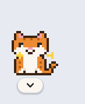
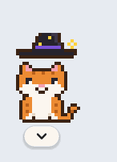

# CAT-GPT: Ginger, a pixel cat that is your personal agent


Ginger is a small ginger-and-white pixel cat that lives on your Mac desktop. You can drag
the cat anywhere. Click it and an input bar pops up underneath it. Tell it what to do, and
when it's finished it tells you what it did in a pixel speech cloud, such as **Code
changed ✓** or **Text changed ✓**. The agent runs on the
[Claude Agent SDK](https://code.claude.com/docs/en/agent-sdk), the same engine as Claude Code,
and by default its brain is a **free AI model through [OpenRouter](https://openrouter.ai)**.
You can switch to Claude itself, or to a model running in Ollama. It can read and edit
code, run commands and search your files, and it also gets a few cat-specific tools:

| Tool | What it does |
|---|---|
| `what_am_i_working_on` | Reports the app, window, browser tab or Word document you were last using |
| `look_at_screen` | Takes a screenshot so the cat can see what you see |
| `show_tip` | Points at a problem in a local file, which gives the cat's speech cloud a **Show me** button that opens the file at the right line |
| `open_in_editor` | Opens a file in VS Code at a given line |
| `copy_to_clipboard` | Puts code or text on your clipboard for you to paste |
| `remember` | Saves lasting facts about you to `~/.ginger/memory.md` |

## Setup (macOS)

You need Python 3.10 or newer.

```bash
git clone https://github.com/oliburr10/CAT-GPT.git
cd CAT-GPT
python3 -m venv .venv
source .venv/bin/activate
pip install -r requirements.txt

export OPENROUTER_API_KEY=sk-or-...   # free, from https://openrouter.ai (Keys)
python run.py
```

The Agent SDK ships with its own copy of the Claude Code engine, so nothing else needs
installing. To avoid exporting the key every time, add the `export` line to `~/.zshrc`.

The first time it starts, the cat picks a free OpenRouter model that can use tools. Some
free models only work for particular apps, so it sends each candidate a tiny test message,
keeps the first one that answers, tells you which one it chose and remembers it. If that
model stops working later, run the self-check, which picks again. To pick one yourself, set `CAT_MODEL`, for example
`CAT_MODEL=openai/gpt-oss-120b:free`. The free models change from time to time, and the
self-check lists the ones available right now.

Then check everything is set up:

```bash
python -m catagent.selfcheck
```

### macOS permissions

The first time the cat checks what you're doing, macOS asks for permission. If you
missed the prompt, enable these in **System Settings → Privacy & Security** for the app you
start the cat from (Terminal, iTerm or VS Code):

- **Accessibility**: lets the cat read window titles.
- **Automation**: lets it ask System Events, your browser and Word what's open.
- **Screen Recording**: lets it take screenshots.

Restart the cat after you change these.

## Using it

- **Drag** the cat anywhere. It remembers where you left it.
- **Click** the cat and an input bar pops up underneath it. Type what you want and press
  **Enter** (or **Esc** to close it). The **+** button attaches a file for the cat to look at.
  The microphone is a placeholder for voice input, which isn't built yet.
- When the cat is done, a **speech cloud** pops up above its head saying what it did:
  *Code changed*, *Text changed*, *File changed*, *Command run*, *Copied to clipboard* or
  *Noted*, plus a sentence or two about it. A question just gets its answer. Click the cloud
  to dismiss it, or it goes away by itself. An action only counts once it actually worked, so
  an edit you turned down never shows up as "Code changed".
- Before the cat **edits a file or runs a command**, the cloud asks first (for example "Can I
  change train.py?"), shows the change, and waits for **Allow** or **Don't**. Reading,
  searching and browsing happen without asking.
- **The arrow under the cat** opens Ginger's panel, a frosted box with:
  - **Mode**: *Study mode* for now (more modes will appear here). Ginger is told which mode
    you're in.
  - **Project** and **+**: pick the project you're working on, or make a new one (like
    *Math 1*). It's the same project the Notepad's clipboard shows, so switching in either
    place switches both, and Ginger is told which project you're in.
  - **Connections**: the apps and sites Ginger may see and work in, each with a green dot
    (connected) or a red one (not connected). **Disconnect** makes a tool off limits: Ginger
    isn't told what you have open in it, won't take a screenshot while it's in front, and for
    VS Code opens files in their default app instead. An amber dot means connected but
    needing setup (VS Code without the `code` command). **Add a tool** adds Google Docs, Word,
    Jupyter, Terminal, Xcode, PyCharm or Notion; right-click a tool to take it off the list.
    Apps that aren't on the list work as they always have.
  - **Open Notepad**.

  On a Mac the panel has a real blur behind it. If that ever misbehaves, start the cat with
  `CAT_FROSTED=0` for a plain light panel. Press **Esc** or click the arrow again to close it.
- **Right-click** the cat for these options: *Talk to Ginger*, *Stop what you're doing*,
  *Look at my screen*, *Open Notepad*, *Costume*, *Watch mode*, *Edit files without asking*,
  *New conversation*, *Quit*.
- **Costumes:** type a costume command in the input bar, or right-click the cat and pick a
  *Costume*, and you watch it dress up.
  - *change costume* (or *change costumes*) picks a different costume at random.
  - *change into dragon*, *change into wizard*, *back to normal*. Variations like *turn into a
    green dragon*, *dress up as a wizard* or *wear the wizard hat* work too.

  These short commands happen instantly and never use the AI. Anything else ("can you put on
  something magical?") goes to Ginger, which can change its own costume too.
  - **Green Dragon:** the green suit pulls up from its feet, then the hood with cream horns and
    an orange crest comes down, with a sparkle. It has a pale belly, a little wing and a
    spade-tipped tail.
  - **Wizard:** a tall black hat with a purple band and gold stars floats down onto its head,
    then its wand appears and sparkles (and twinkles now and then).
  - **Ginger:** back to plain, in a puff of sparkles.

  Every costume has every pose: napping, coding with glasses, the wake-up stretch. The cat
  remembers its costume. The pixel art is in [`catagent/costumes.py`](catagent/costumes.py).

   
- Each instruction automatically includes the app or file you were in just before clicking
  the cat, so "fix this" just works.
- The cat's moods: `...` means it's thinking, and a red `!` means it has a tip for you.
- **Nap time:** after 30 seconds with nothing to do (`SLEEP_AFTER_SEC`), the cat curls up,
  rests its head on its paws and breathes slowly while little z's float up from its head.
  It stays awake while the input bar or a cloud is open. Click it and it opens its eyes, has
  a big stretch and a yawn, and then the input bar appears.

  
- **Coding mode:** while the cat is working on a coding task, it puts on its glasses and types
  away on a little laptop, stopping now and then to read the screen. A task counts as coding
  if you asked from a code editor or terminal, if your message sounds like code (bugs, tests,
  `.py` files and so on), or as soon as the cat starts editing files or running commands. The
  glasses come off when it's done. The rules are in [`catagent/activity.py`](catagent/activity.py).

  

### The Notepad: study notes and your clipboard

Ask the cat to help you understand, solve or prove something ("Prove that Trace(AB) =
Trace(BA), I'm stuck"), from its input bar or from the Notepad, and instead of a speech cloud
it writes **study notes** and opens them in the Notepad. Right-click the cat and choose
*Open Notepad* to open it yourself. The notes always teach in the same order:

1. **What you have**: every definition and fact you start from, as a formula, each with what
   it means in plain words, then the goal.
2. **Solve it step by step**: each step starts from a formula, says which facts it uses,
   continues the same small example as a colour-coded picture (say, the entries of *A* in
   beige, *B* in blue and the diagonal in green, matching the colours in the formulas and the
   text), and ends with *What it means*.
3. **Complete solution**: the whole solution in one box, step by step, with the key idea and
   a mistake to watch out for.

There are no quizzes. Ask about any step in the chat box at the bottom ("explain step 3
again") and the cat answers there or rewrites the notes. **Export .tex** saves them as a
LaTeX file that compiles with pdflatex or in Overleaf.

The **Clipboard** panel on the right (the *Clipboard* button shows and hides it; opening it
widens the window, so it never covers your notes) is where you keep what you've learned:

- **+ Folder** and **+ Subfolder** build your own structure, e.g. *Week 1 › Questions*, *Exams*,
  *Projects*. **+ Note** saves a study note or a project idea into the selected folder.
- Pick a folder and press **Clip here** (or **Clip solution** on the complete-solution box)
  to file the open notes there, with **Undo**. Pick another folder and **Move here** to move them.
- Click any clip to open it again. **Search clips** finds anything by name.
- The project menu at the top left switches between projects (like *Math 1*) or makes a new one.

Everything is saved as real files in `~/Ginger/<project>/...` (one `.json` file per clip),
so you can also browse, back up or sync them in Finder. The folder button in the panel opens
it. To try the Notepad without asking the cat anything, run `python -m catagent.notepad`,
which opens it on an example.

How good the notes are depends on the model. The cat checks every set of notes before
showing them (missing sections, maths outside `$...$`, colours without a meaning in the key)
and sends them back to the model with a list of what to fix. Claude Haiku passes within one or
two tries; free models vary, so if one keeps failing, set `CAT_MODEL` to a stronger free model.

### Watch mode

With watch mode on, the cat glances at your screen whenever you switch to something new
and stay on it for a little while. It checks at most once every
`WATCH_INTERVAL_SEC` (2 minutes by default). If it spots a real problem, such as an error
message, a failing test, a LaTeX error or an obvious typo, it says so in its speech cloud
and shows a red `!`. If not, it stays
quiet. Watch-mode checks can't edit anything. Each check is a paid model call that includes a
screenshot, so watch mode is **off by default**.

### What it can do in each app

| Where you're working | What the cat can do |
|---|---|
| VS Code or any local code | Read, explain and edit the files directly (with your approval), run tests, open the exact line |
| Word (`.docx` on disk) | Find the document's path and read it. To edit, close the file in Word first, then the cat can edit it with `python-docx` |
| Overleaf | It can see the page and tell you exactly what to change. If you sync the project locally (Overleaf's Git integration), it can edit the `.tex` files directly |
| Google Docs | It can see the page and tell you exactly what to change and where. It can't edit Google Docs directly yet |

## How do I know it actually works?

Don't take the cat's word for it. Three commands check it for you.

**1. The self-check** confirms the setup: Python and packages, that the agent can log in, the
model, every tool the cat should have (and nothing unexpected), and on a Mac whether it can
see your apps, take screenshots and use the clipboard. It makes one tiny model call (free
with a free model).

```bash
python -m catagent.selfcheck
```

**2. The coding exam** checks the cat can really program. Each task in
[`evals/tasks`](evals/tasks) is a small broken project plus a request like one you'd type:

| Task | What it tests |
|---|---|
| `pagination` | "The tests are failing, fix it": two bugs in one file |
| `grades_crash` | A pasted traceback, and an edge case the traceback doesn't mention |
| `invoice_rounding` | A customer complaint where the bug lives in a different file from the symptom |
| `slugify_feature` | Building a feature from a written spec, with tests |

The cat works on a temporary copy, using exactly the same setup as the app, with every
permission question answered "Allow". Then each result is graded like a code review:

- **Correct:** hidden tests the cat never saw all pass, along with the project's own tests
- **Honest:** it didn't edit or delete the existing tests to make them pass
- **Tested:** it ran the tests itself
- **Focused:** it changed only as many lines as the fix needs
- **Tidy:** no stray files or debug prints left behind
- **Tests added:** for the feature task, it wrote tests for the new code

```bash
python -m evals.run                    # all tasks (free with a free model, a few cents on Haiku)
python -m evals.run grades_crash       # just one
python -m evals.run --keep             # keep the folders so you can read what it changed
```

Run it again whenever you change the model or the personality, so you know nothing got
worse. To test a new kind of job, add a folder in `evals/tasks` with a `task.json`, a
`project/` and `hidden_tests/`.

**3. SWE-bench** is the standard benchmark for AI software engineers. It uses real GitHub
issues from real Python projects (Django, sympy, scikit-learn, matplotlib, pytest and
others), and grades each fix by running that project's own test suite, including tests
written for the fix that the cat never sees. The default set, SWE-bench Verified, has 500
issues that people have checked are fair and solvable. Published scores for AI coding
agents are on [swebench.com](https://www.swebench.com).

For each issue, the cat gets the project at the right commit in the task's official Docker
container. It works on it with the same setup the app uses, plus a `run_in_project_env`
tool that runs Python and the tests inside that container with its latest edits. Its
change is then graded by the official SWE-bench harness.

You need Docker Desktop running, and one extra install:

```bash
pip install -r evals/requirements-swebench.txt

python -m evals.swebench --gold --sample 2    # free: grades SWE-bench's own reference fixes, to check grading works
python -m evals.swebench                      # the cat on a random sample of 10 issues
python -m evals.swebench --sample 50          # a more precise score
python -m evals.swebench --instances django__django-11099 sympy__sympy-20590
python -m evals.swebench --all                # all 500
python -m evals.swebench --run-id run-20261018-1200   # resume an interrupted run
```

It prints which issues the cat resolved and its score, for example "Resolved 7/10 (70%)".
Results, the cat's patches and a log of every step it took go to
`~/.ginger/swebench/<run id>/`.

Things to know:

- **Cost and time:** each issue is a real coding session, usually a few minutes. That's
  well under a dollar on Haiku, and roughly $0.50–$3 on Opus. `--budget` (dollars) and
  `--minutes` cap each issue. Ten issues is a quick,
  rough check; the full 500 is a serious spend.
- **Small samples are rough:** with 10 issues, one more or fewer solved moves the score by
  10 points. Use 50 or more before comparing with published numbers.
- **Docker images are big:** each issue's image is 1–3 GB. Clean up afterwards with
  `docker image prune -a`.
- **Apple Silicon Macs:** the images are built for Intel, so turn on *Use Rosetta for
  x86_64/amd64 emulation* in Docker Desktop's settings. Everything runs, just slower.
- **Docker Hub limits:** pulling many images can hit Docker Hub's download limit ("429 Too
  Many Requests"). Signing in with a free account (`docker login`) raises it.

### How the cat is set up to code well

- Underneath, it runs the same agent as Claude Code, including Claude Code's own coding
  instructions (the `claude_code` system prompt preset).
- On top of that, its personality in [`catagent/config.py`](catagent/config.py) spells out how to
  work like a careful programmer: read the code and its tests first, fix the real cause,
  make the smallest change, never edit a test just to make it pass, add tests for new
  behaviour, run the tests afterwards and say honestly whether they pass, and leave nothing
  messy behind.
- It can run test and git-inspection commands without asking (`pytest`, `npm test`,
  `git diff`, ...). The full list is `SAFE_COMMANDS` in [`catagent/agent.py`](catagent/agent.py).
  Edits and any other command still ask first, unless you turn on **Edit files without
  asking** in the right-click menu. Even then, other commands still ask. If you use that
  mode, keep your projects in git so you can always see and undo what changed.

### Choosing the AI, and what it costs

`CAT_PROVIDER` chooses the cat's brain:

| `CAT_PROVIDER` | Key | Cost | Notes |
|---|---|---|---|
| `openrouter` (default) | `OPENROUTER_API_KEY` | Free with `:free` models | Daily limits; weaker than Claude |
| `anthropic` | `ANTHROPIC_API_KEY` | Pay as you go (Haiku: fractions of a cent per request) | Strongest at coding (21/21 on the exam) |
| `ollama` | none | Free | Runs a model on your Mac (needs a lot of memory) or in Ollama's cloud |

Things to know about OpenRouter's free models:

- **Daily limits.** Free models allow a limited number of requests per minute and per day, and
  the cat makes one request for every step it takes. A coding task can take 10–30 steps, so
  you get roughly a handful to a few dozen tasks a day. OpenRouter's site has the current
  limits. If you hit one, wait or switch model.
- **Privacy.** Some free models are run by providers that may store or train on what you
  send. If OpenRouter says "No endpoints found matching your data policy", allow free
  models in its privacy settings, and don't send the cat anything secret.
- **Quality.** Free models are less reliable than Claude at multi-step work like editing
  the right file or running tests. Check them with the coding exam (`python -m evals.run`),
  which is free to run with a free model.
- **No web search.** Web search only works with Claude's own servers, so the cat leaves it
  out with other providers. It can still fetch web pages.
- With OpenRouter or Ollama, the cat's engine uses its own settings folder
  (`~/.ginger/engine`), so it never reads or sends your personal Claude login.

With Claude, set a monthly spending limit in the Claude Console so you can't be surprised,
and leave watch mode off, since it's the only feature that makes requests without you
asking. The cost the self-check and the exam print is the Agent SDK's own estimate; your
real bill is in the Claude Console.

## Making it yours

All the settings are in [`catagent/config.py`](catagent/config.py):

- `CAT_NAME`, `PERSONALITY`: who the cat is and how it talks
- `PROVIDER` and `MODEL`: which AI powers it (see "Choosing the AI" above). With
  `CAT_PROVIDER=anthropic` the default is Claude Haiku 5.5, the cheapest, which scores
  21/21 on the coding exam; `claude-sonnet-5-5` and `claude-opus-5-5` are smarter but cost
  more.
- `WORKSPACE`: the folder it starts in (point it at your code folder)
- `SCALE`: how big the cat is
- `SLEEP_AFTER_SEC`: how long before it naps
- `WATCH_INTERVAL_SEC`
- `FROSTED`: the blur behind the panel (set `CAT_FROSTED=0` to turn it off)
- `NOTES_DIR`: where the Notepad's clipboard keeps your projects (`~/Ginger`, or set
  `CAT_NOTES_DIR`)

The cat's look is defined in [`catagent/sprites.py`](catagent/sprites.py) as ASCII grids,
one letter per pixel. Edit the letters to redraw it, or add frames.

Its memory is a plain file, `~/.ginger/memory.md`, that you can open and edit yourself.

## How it fits together

```
run.py
catagent/
  app.py          wires everything together; window placement, watch mode, saved state
  cat_widget.py   the draggable, animated cat window
  command_bar.py  the input bar that pops up under the cat
  panel.py        the frosted panel behind the arrow: mode, project, connections, Notepad
  connections.py  which apps and sites Ginger may see and work in
  speech_cloud.py the pixel speech cloud: results, tips and Allow/Don't questions
  agent.py        the Claude Agent SDK session, on a background asyncio thread
  activity.py     what counts as coding, and the "Code changed" style labels
  tools.py        the cat's own tools (screen, context, tips, clipboard, memory, study notes)
  notepad.py      the Notepad window and the bridge its page talks to
  web/            the Notepad page (HTML, CSS, JS) and KaTeX for the maths
  study.py        the study-notes format, its checks, and the .tex export
  clipboard.py    projects, folders and clips, as files in ~/Ginger
  examples.py     example study notes (Trace(AB) = Trace(BA))
  providers.py    which AI it talks to: OpenRouter, Ollama or Claude
  selfcheck.py    `python -m catagent.selfcheck`: is everything set up?
  context.py      macOS helpers: frontmost app, browser tab, Word doc, screenshots
  memory.py       long-term memory file
  sprites.py      the pixel art
  costumes.py     the Green Dragon and Wizard costumes, and their dressing-up animations
  config.py       settings and personality
evals/
  run.py          `python -m evals.run`: the coding exam
  tasks/          one folder per exam task: task.json, project/, hidden_tests/
  swebench.py     `python -m evals.swebench`: the cat on SWE-bench, graded by the official harness
tests/            `python -m pytest tests`: the clipboard, connections, costumes, the notes checks and the .tex export
```

Qt runs the UI on the main thread. The agent runs on its own asyncio loop in a background
thread, and the two communicate through Qt signals.

## Ideas for what's next

- A global hotkey to summon the cat
- Calendar, Reminders and Notes tools (via AppleScript or Shortcuts)
- Google Docs editing through the Google Docs API
- Voice: a wake word plus speech-to-text (an intention-based speech enhancement
  model could clean up the audio first)
- Launch at login (a LaunchAgent or a packaged `.app` via `py2app`)
